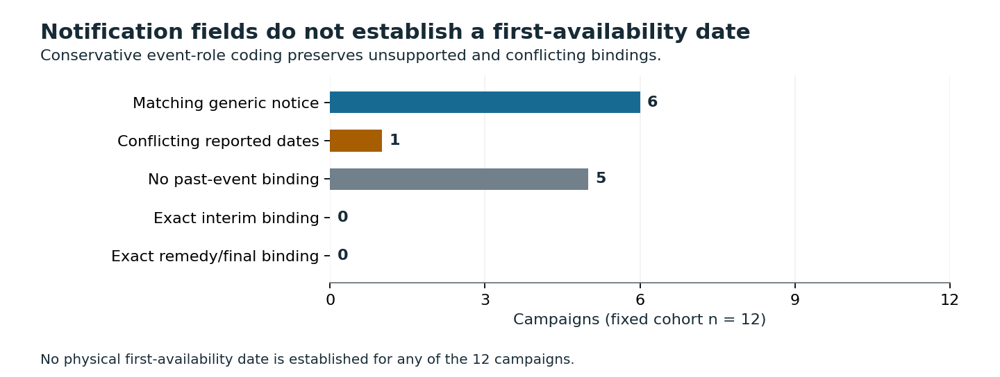

# Check the event before using a recall date

A generic notification date can become the wrong label for a remedy-time model. This repository audits twelve NHTSA campaigns and supplies a local guard that keeps each date attached to its event role, certainty and evidence.

**Finding:** six campaigns match current generic notification assertions, one has conflicting source dates, and five lack a supported past-event binding. For 23V005, the flat file says **7 February 2023**, while the current API reports letters mailed **2 March 2023**. The audit flags the discrepancy; it does not determine why the sources differ.

No physical first-availability date is established for any campaign. The original time-to-remedy prediction remains unexecuted because the outcome-label and initial-vintage gates remain unresolved.

## Use it

A data engineer reviewing a proposed recall label table can preserve the source role and reject unsupported conversions before training or reporting turnaround times. This is a local implementation exercise; no production deployment, measured saving or safety benefit is claimed.

~~~powershell
python -m pip install -r requirements.txt
python src/replay.py --out ../recall-audit-replay
~~~

Use a new output folder. The replay checks frozen inputs, reproduces all four result files, checks independent SQLite reconstruction and authored fixtures, and verifies the published figures and manuscript. It uses saved factual projections; it does not redownload source documents or repeat semantic adjudication.

The [six runnable examples](results/exercise.json) retain a supported generic notice and reject notification-as-availability, planned-as-reported, an undated interim template, conflicting source evidence and missing evidence. See [the implementation exercise](EXERCISE.md) and [guard code](src/guard.py).

## Evidence

- [Independent five-page manuscript](paper/manuscript.pdf) and [LaTeX source](paper/main.tex), with three original figures. Not peer reviewed.
- [All twelve case outcomes](results/cases.json), [all 29 planned report ranges](results/planned_references.json), [all 60 document adjudications](data/document_adjudication.json) and [current API assertions](data/api_notice_assertions.json).
- [Fixed protocol](PROTOCOL.md), [coding rules](CODEBOOK.md), [committed source/method freeze](PLAN_FREEZE.json), [source-history qualifications](SOURCE_HISTORY.md) and [data rights](DATA_RIGHTS.md).
- Native flat/API projection: 247,156 finite conditions. Document/hash/page checks: 712 automated conditions plus retained native-page visual checks. Saved projection: 720 conditions. Independent SQLite/calendar/exercise reconstruction: 152 conditions. Authored fixtures: 26 tests.
- Separate full-history CPython [3.10.11](results/reproduction_cpython310.json) and [3.12.14](results/reproduction_cpython312.json) replays reproduce four files exactly, with all 13 source projections unchanged.
- [Figure verification](figures/verification.json) checks 36 source-bound artists, 60 actual SVG coordinate conditions and nine hashes. [Manuscript verification](paper/verification.json) checks used source bindings, PDF text, complete case coverage and scoped bytes.

## Read the limits

The cohort is fixed by early 2023 campaign number, source informed and unrepresentative. Dates come from current sources and amended documents; immutable original filing availability is unverified. A printed letter date, sample watermark, generic final-letter label or expected mailing date does not prove delivery or an exact final-notification event. Dealer and OTA availability can differ.

The source discrepancy might reflect phases or revisions. It is not a national error estimate or proof that an agency field is wrong. Date equality is not zero repair delay. No model, tuning, causal effect, remedy-time distribution or new estimator is claimed.

Native archives/PDFs, contact blocks and vehicle identifiers remain private. The public package contains attributed factual projections, necessary short clauses, code and this independent program manuscript. Azure optimization and other formal-publication projects remain private.
